# MILK10k skin-lesion classification: MLOps project

> **Research model, not a medical device.** It was developed for the ISIC MILK10k research benchmark; its output is
> not a diagnosis and must not be used for clinical decisions.

A skin-lesion classifier (an ensemble of 15 networks over a dermoscopic image, an optional clinical image and four
metadata fields; [`training/`](training/README.md)) served as a torch-free FastAPI service with ONNX Runtime, run
with Docker Compose together with Prometheus, Grafana and Jaeger, and tested, built and deployed by a Jenkins pipeline.

**Status:** the required parts run locally; the Kubernetes and cloud parts are planned.

## Contents

- [Architecture](#architecture)
- [Repository structure](#repository-structure)
- [Notebooks](#notebooks)
- [Install and run on Ubuntu](#install-and-run-on-ubuntu)
- [API](#api)
- [Grading evidence](#grading-evidence)
- [Troubleshooting](#troubleshooting)
- [Licence](#licence)

## Architecture

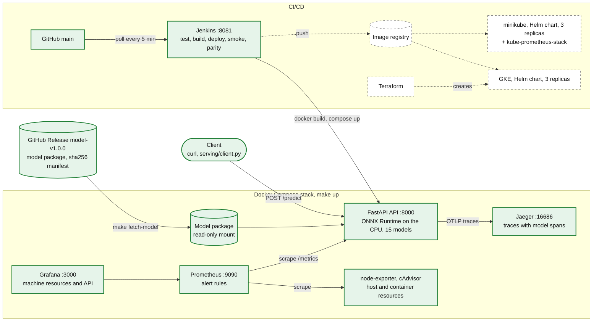

Green and solid: running now. Dashed: planned (Kubernetes and cloud). The detailed diagrams (every component, the
`POST /predict` request path, the pipeline stages and the CI network) are in [docs/architecture.md](docs/architecture.md).

## Repository structure

```text
.
├── training/             the released model package `milk10k` (code, configs, notebooks 01–07, results, model card); kept unchanged
├── notebooks/            notebook 08: ONNX export, model package, parity check (stage 4 of the notebook requirement)
├── serving/              the torch-free `milk10k_serving` package, its FastAPI app, the API image (Dockerfile) and a client
├── tests/                PyTest suite for the serving code (unit, API, parity)
├── monitoring/           Prometheus (scrape config, alert rules), Grafana (provisioned dashboard), Jaeger configuration
├── ci/                   Jenkins in its own Compose project, configured as code (plugins, JCasC, job)
├── scripts/              model download and check, smoke test, repository hygiene check
├── benchmarks/           the scripts behind the serving measurements
├── docs/                 architecture, install guide, serving measurements, full parity report
├── k8s/                  Helm chart for the API on a local Kubernetes cluster (minikube), Prometheus + Grafana
│                         via Helm (monitoring/), and the step-by-step guide
├── deploy/               Terraform for the cloud (planned)
├── compose.yaml          the local stack: API + Prometheus, node-exporter, cAdvisor, Grafana, Jaeger
├── Jenkinsfile           the pipeline: test → build → deploy → smoke → parity → Kubernetes
├── Makefile              every command of this README (`make help`)
├── pyproject.toml        repository-wide tool settings (pytest, ruff)
├── .env.example          template of `.env` (settings and the Grafana password; `.env` is never committed)
├── .gitignore
└── LICENSE               MIT for the code; data and model terms in Licence below
```

## Notebooks

The four stages of the notebook requirement:

| Stage | Notebook |
|---|---|
| 1. EDA | [01_data_overview](training/notebooks/01_data_overview.ipynb), [02_eda](training/notebooks/02_eda.ipynb) |
| 2. Data processing (cleaning, split) | [03_preprocessing_and_features](training/notebooks/03_preprocessing_and_features.ipynb) (folds built in 01) |
| 3. Modeling (training and evaluation) | [04_modeling_and_training](training/notebooks/04_modeling_and_training.ipynb), [05_evaluation](training/notebooks/05_evaluation.ipynb), [06_experiments_summary](training/notebooks/06_experiments_summary.ipynb) |
| 4. Prepare for deployment | [07_inference](training/notebooks/07_inference.ipynb) (inference and parity), [08_export_for_deployment](notebooks/08_export_for_deployment.ipynb) (ONNX export and model package) |

The notebooks are stored with their outputs, so they can be read on GitHub without running them. Running them needs
the MILK10k data and the checkpoints ([training/README.md](training/README.md#quick-start),
[notebooks/README.md](notebooks/README.md)).

## Install and run on Ubuntu

### Prerequisites

Ubuntu with Docker Engine and its Compose plugin, your user in the `docker` group, `git`, `make`, `curl`, `python3`
and [uv](https://docs.astral.sh/uv/) for the tests. Step-by-step commands, and the reference machine all numbers come
from (Ubuntu 26.04 LTS, 16 GB RAM, 16 CPU threads, Docker 29.9.3, Compose v5.7.1):
[docs/install-ubuntu.md](docs/install-ubuntu.md).

### Get the code

```bash
git clone https://github.com/Yogurt01/milk10k-skin-lesion-mlops.git
cd milk10k-skin-lesion-mlops
```

### Run the stack with Docker Compose

Needs Docker with Compose v2, `curl` and `python3`. From the repository root:

```bash
make up      # creates .env (random Grafana password) if missing, downloads the model package (~1.4 GB, once;
             # sha256-checked), builds the API image, starts the stack and waits until every service is healthy
curl -s localhost:8000/ready
make down    # stops it (Prometheus and Grafana data volumes are kept; `docker compose down -v` removes them)
```

| Service | URL (127.0.0.1 only) | What |
|---|---|---|
| API | http://localhost:8000 | `/health`, `/ready`, `/predict`, `/metrics`, `/docs` |
| Prometheus | http://localhost:9090 | scrapes the API, node-exporter, cAdvisor and itself; alert rules at `/alerts` |
| Grafana | http://localhost:3000 | dashboard "MILK10k: machine resources and API"; user `admin`, password = `GRAFANA_ADMIN_PASSWORD` in `.env` |
| Jaeger | http://localhost:16686 | traces of `/predict` (service `milk10k-api`) |

- **Model download:** `make up` runs `scripts/fetch_model.sh`, which downloads the model package from the GitHub Release [`model-v1.0.0`](https://github.com/Yogurt01/milk10k-skin-lesion-mlops/releases/tag/model-v1.0.0) into `artifacts/model_package/final-P1a-kg-onnx/`. Interrupted downloads resume; files already verified are skipped.
- **Model files:** the model package (CC BY-NC 4.0, non-commercial) is not in the image. Compose mounts it read-only.
- **Network:** the API listens on `127.0.0.1:8000` only.
- **Settings:** `.env` (gitignored; template `.env.example`). `make env` creates it with a random Grafana admin password;
  Compose refuses to start without one (no `admin/admin` fallback).
- **Monitoring configuration:** [`monitoring/`](monitoring/) (Prometheus scrape config and alert rules, Grafana
  provisioning and dashboard, Jaeger configuration). node-exporter and cAdvisor read host folders read-only; cAdvisor
  also reads the Docker and containerd sockets to name containers, which gives it control over Docker (see
  `compose.yaml`).

### Tests

```bash
make setup    # serving venv in serving/.venv with uv (Python 3.12, pinned requirements)
make test     # fast tests: unit and API, no model package needed
make lint     # ruff
```

The parity tests compare the API with the stored reference predictions of the released model (tolerance 0.002 per
probability). They need six sample lesions from the MILK10k test set, which are dataset images and never in git. With
the dataset downloaded from the [ISIC Archive](https://challenge.isic-archive.com/data/#milk10k) and prepared as in
[training/data/README.md](training/data/README.md) (a folder with `test_metadata.csv`, `test/derm/`,
`test/clinical/`):

```bash
make sample SAMPLE_DATA_DIR=/path/to/prepared/milk10k   # copies the 6 sample lesions into training/sample/ (gitignored)
make test-all         # every test, incl. parity in-process and through HTTP
make test-container   # parity through HTTP against the running stack from make up
```

All 479 test lesions through the API: [docs/parity_full.md](docs/parity_full.md) (479 / 479 within the tolerance).

### CI with Jenkins

A local Jenkins (Compose project `milk10k-ci`, UI on http://127.0.0.1:8081) runs the [Jenkinsfile](Jenkinsfile) on
every push to `main`: unit tests ‖ lint ‖ hygiene → build the API image → deploy with Compose → smoke test → parity
on the deployed API. Setup (`make ci-up`), security notes and pitfalls: [ci/README.md](ci/README.md).

## API

FastAPI service in [`serving/`](serving/) (`milk10k_serving.api`). Start it from the repository root with
`make serve` (port 8000; settings from environment variables, see [`.env.example`](.env.example)). The model package
loads in the background, so `/ready` turns 200 a few seconds after start. Interactive docs: `http://localhost:8000/docs`.

| Endpoint | Purpose |
|---|---|
| `GET /health` | Liveness: always 200 while the process runs (also while loading and under overload) |
| `GET /ready` | Readiness: 200 once the model is loaded and verified, 503 while loading or after a failed load |
| `POST /predict` | One lesion: dermoscopic image (required), clinical image (optional), metadata → P(malignant), 11 class probabilities, diagnosis, `disclaimer` |
| `GET /metrics` | Prometheus metrics: requests by route template / method / status, latency histogram, running and waiting predictions, 503-busy rejections, model readiness and load time, stage durations, P(malignant) histogram |
| `GET /docs`, `GET /openapi.json` | OpenAPI documentation, including the allowed metadata values once the model is loaded |

```bash
curl -s localhost:8000/health
# {"status":"ok"}

curl -s localhost:8000/ready
# {"status":"ready","model":"final-P1a-kg-onnx","model_version":"1.0.0","load_seconds":3.27}

# Images from the sample lesions (built by training/sample/make_sample.py; not in git)
curl -s -X POST localhost:8000/predict \
  -H 'X-Request-ID: readme-example-1' \
  -F derm_image=@training/sample/images/test/derm/ISIC_0145429.jpg \
  -F clinical_image=@training/sample/images/test/clinical/ISIC_7021698.jpg \
  -F age_approx=60 -F sex=male -F anatomical_site_general=head/neck -F fitzpatrick_type=5
# {"p_malignant":0.8439921140670776,"probabilities":{"AKIEC":0.1065...,"SCCKA":0.5778...,...},"diagnosis":"SCCKA",
#  "clinical_image_used":true,"model":"final-P1a-kg-onnx","model_version":"1.0.0","metadata_missing":[],
#  "disclaimer":"Research model for the ISIC MILK10k benchmark, not a medical device. ..."}

curl -s localhost:8000/openapi.json | python3 -m json.tool | head
```

Python client (standard library only): `python3 serving/client.py ISIC_0145429` prints the diagnosis, P(malignant)
and the disclaimer for a sample lesion (`--base-url`, `--sample-dir` to change the defaults).

**Form fields of `/predict`:** `derm_image` (required), `clinical_image` (optional; a missing or undecodable clinical
image is treated as missing), `sex` and `fitzpatrick_type` (required), `age_approx` (0-120) and
`anatomical_site_general` (optional: omitted or empty is encoded as missing and listed in `metadata_missing`).
Allowed values come from the model package's `tabular_encoding.json`.

| Status | When |
|---|---|
| 200 | Prediction; `disclaimer` is always present |
| 400 | The body is not parseable multipart form data |
| 413 | The body is larger than two images at `MAX_UPLOAD_MB` plus 1 MB (from `Content-Length`), or one image is larger than `MAX_UPLOAD_MB` |
| 422 | `sex` or `fitzpatrick_type` missing; a value outside the allowed set; dermoscopic image missing, empty or not decodable; an image above `OPENCV_IO_MAX_IMAGE_PIXELS` decoded pixels |
| 503 | Model loading (`Retry-After`) or failed to load; or server busy (`Retry-After`) |
| 500 | Unexpected error; generic message only |

- **Validation order:** readiness is checked before field validation, so while the model is not ready every
  `/predict` gets 503, even one with an invalid field.
- **Overload:** at most `MAX_CONCURRENT_PREDICTIONS` predictions run at once and `MAX_QUEUED_PREDICTIONS` more wait;
  further requests get 503 with `Retry-After` at once. Overload is not "not ready": `/ready` stays 200.
- **Tracing:** with `OTEL_EXPORTER_OTLP_ENDPOINT` set (the Compose stack sets `http://jaeger:4318`), each `/predict`
  becomes one trace: server span, `queue_wait`, `validate_input`, `decode`, `preprocess`, `inference` (one span per
  ensemble member) and `assemble_response`. Spans carry counts and flags, never images or metadata values. A stopped
  Jaeger never breaks `/predict`.
- **Request ids:** every response carries `X-Request-ID` (the client's value if it is 1-64 characters of
  `[A-Za-z0-9._:-]`, otherwise a generated one); the server's log lines for that request carry it too. Logs contain
  ids, sizes, status and latency, never images or metadata values.

## Grading evidence

| Item | Evidence | Screenshot |
|---|---|---|
| Python 5% | Packaged code: [`serving/`](serving/) (`milk10k_serving`, [pyproject.toml](serving/pyproject.toml)) and [`training/`](training/) (`milk10k`); notebooks: [Notebooks](#notebooks) | — |
| Ubuntu 5% | [Install and run on Ubuntu](#install-and-run-on-ubuntu), [docs/install-ubuntu.md](docs/install-ubuntu.md), [Troubleshooting](#troubleshooting) | — |
| FastAPI 5% | [`api.py`](serving/src/milk10k_serving/api.py); endpoints in [API](#api); OpenAPI at `/docs` | — |
| PyTest in CI/CD 5% | [`tests/`](tests/README.md); stage Test of the [Jenkinsfile](Jenkinsfile) (JUnit report, coverage at least 90 %) | <a href="docs/images/jenkins-tests.png">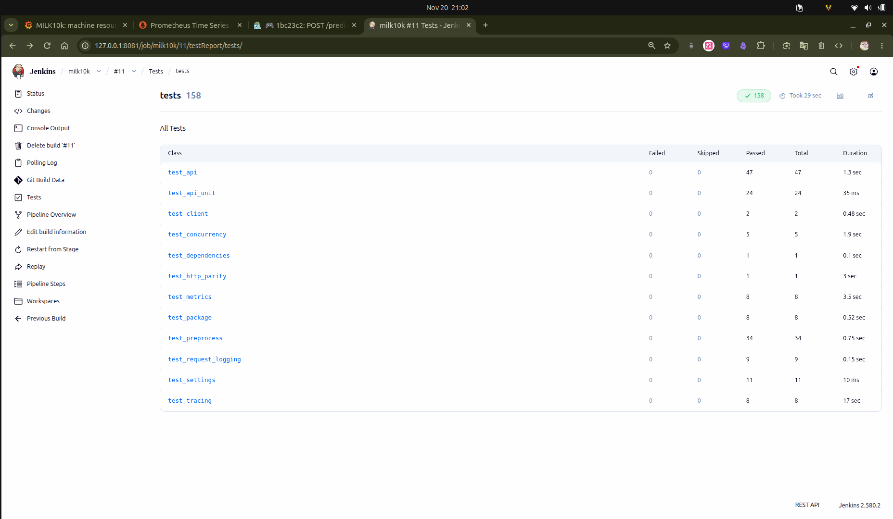</a> |
| Docker Compose 10% | [compose.yaml](compose.yaml); one command: `make up` ([Run the stack](#run-the-stack-with-docker-compose)) | <a href="docs/images/grafana-containers.png">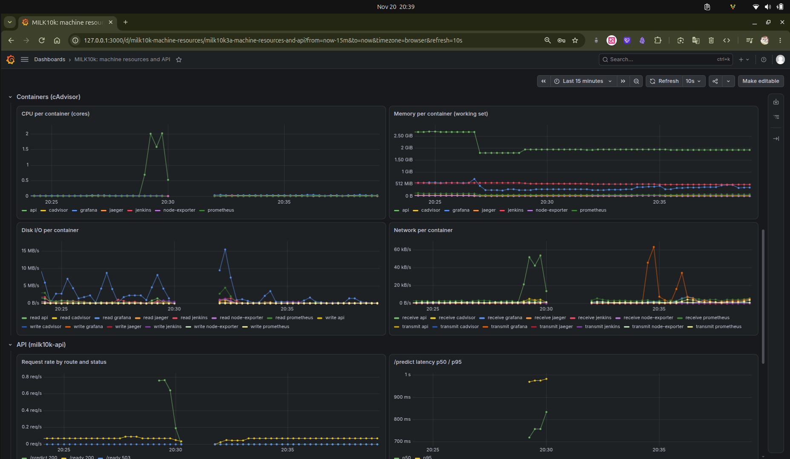</a> |
| Prometheus 5% | [`metrics.py`](serving/src/milk10k_serving/metrics.py) (`/metrics`); [monitoring/prometheus/](monitoring/prometheus/) (scrape config, alert rules with unit tests) | <a href="docs/images/prometheus-targets.png">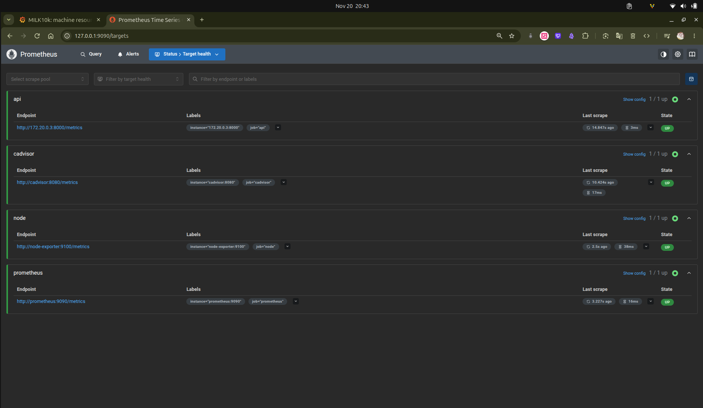</a> |
| Grafana: machine resources 5% | [monitoring/grafana/](monitoring/grafana/): provisioned dashboard with host CPU, memory, disk and network, per-container resources and API panels | <a href="docs/images/grafana-host.png">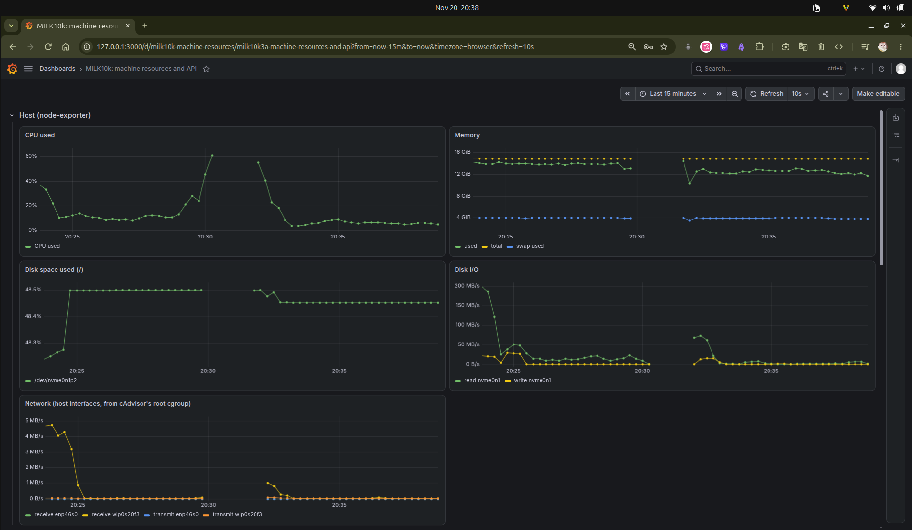</a><br><a href="docs/images/grafana-api.png">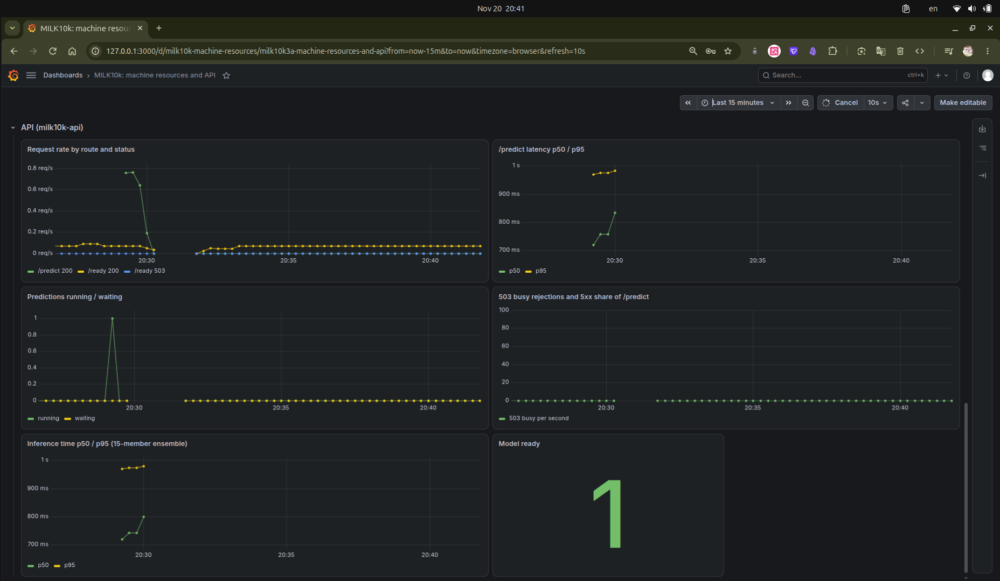</a> |
| Jaeger with OpenTelemetry 5% | [`tracing.py`](serving/src/milk10k_serving/tracing.py): one trace per `/predict` with spans for decoding, preprocessing and each model's inference; [monitoring/jaeger/](monitoring/jaeger/config.yaml) | <a href="docs/images/jaeger-trace.png">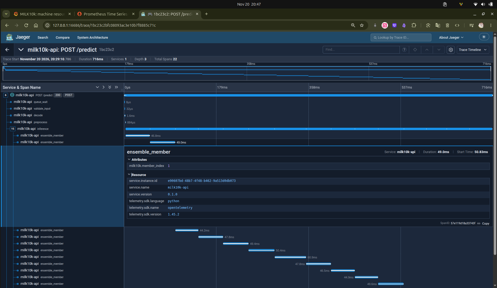</a> |
| Jenkins 5% | [Jenkinsfile](Jenkinsfile) (test → build → deploy → smoke → parity, then a Kubernetes deploy of the same image); Jenkins as code in [ci/](ci/README.md) | <a href="docs/images/jenkins-pipeline.png">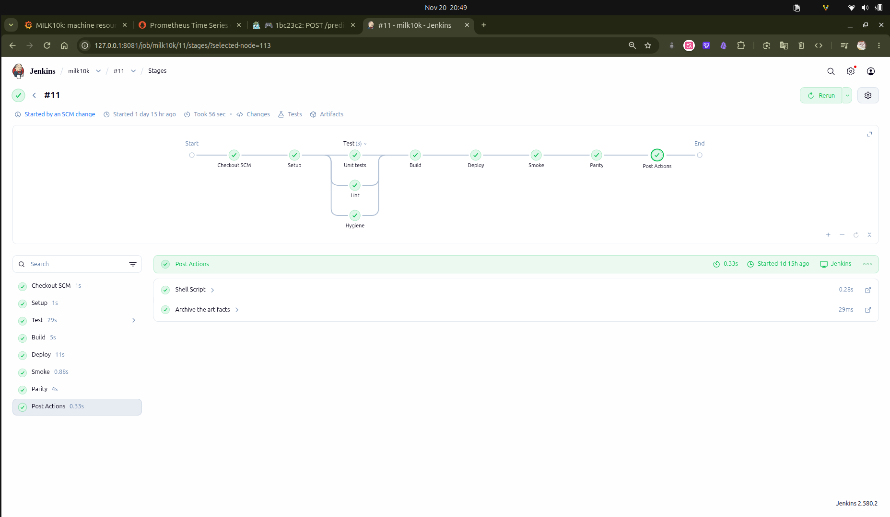</a><br><a href="docs/images/jenkins-k8s-stage.png">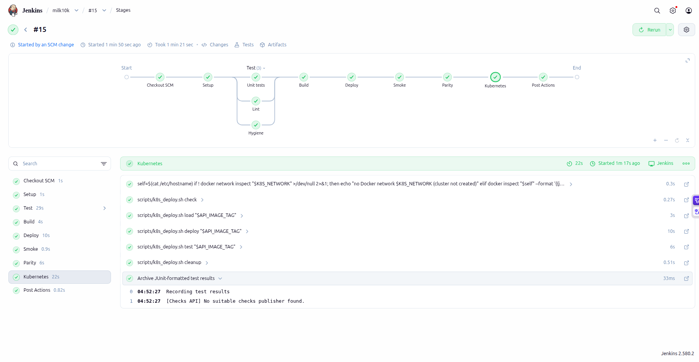</a> |
| Practical 30%: correct results | Parity tests [test_predictor_parity.py](tests/test_predictor_parity.py) (in-process) and [test_http_parity.py](tests/test_http_parity.py) (HTTP), run by the Jenkins Parity stage against the deployed image; all 479 test lesions: [docs/parity_full.md](docs/parity_full.md) | <a href="docs/images/jenkins-tests.png"></a> |
| Bonus: API on Kubernetes with 3 replicas 5% (local cluster) | Helm chart [k8s/milk10k-api/](k8s/milk10k-api/) (`replicaCount: 3`, probes, requests and limits, sha256 check of the model in an init container), run on a local minikube cluster with `make k8s-deploy`: [k8s/README.md](k8s/README.md#what-was-checked) (spread over the Pods, parity, self-healing, rolling update). The screenshots of 3 replicas are from that run by hand. Jenkins deploys each build to the same cluster with 1 replica next to the Compose stack and rolls back a failed deploy ([ci/README.md](ci/README.md#the-kubernetes-stage); last two screenshots: the Pod from a polling build, and the rollback drill). Prometheus + Grafana on Kubernetes and a reproduction guide for them are still planned | <a href="docs/images/k8s-pods.png">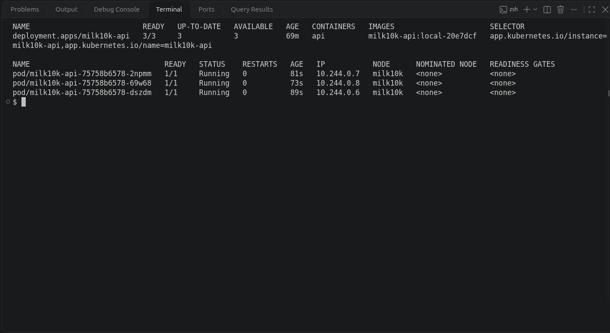</a><br><a href="docs/images/k8s-spread.png">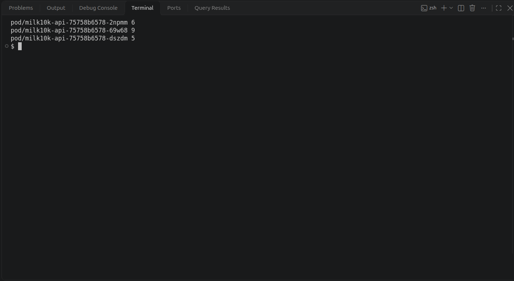</a><br><a href="docs/images/k8s-verify-model.png">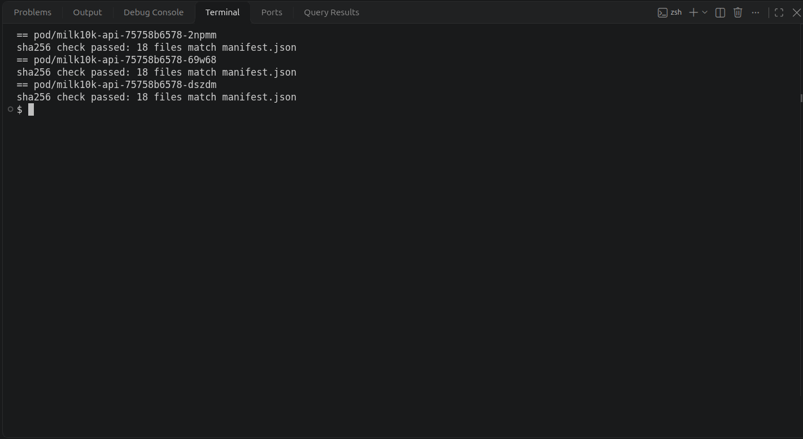</a><br><a href="docs/images/k8s-describe.png">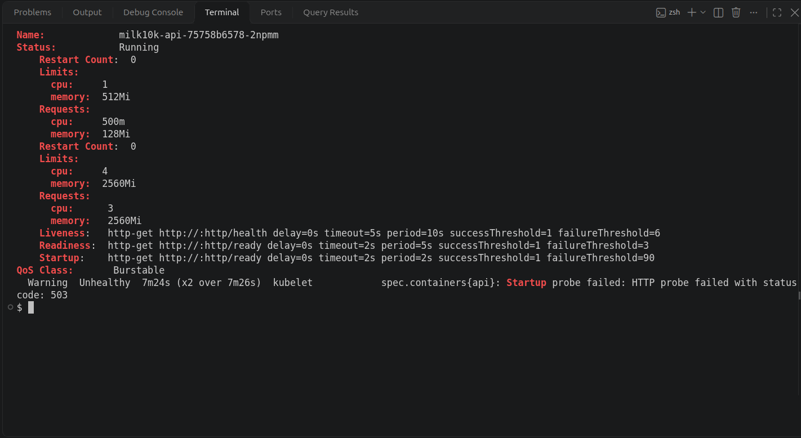</a><br><a href="docs/images/helm-list.png">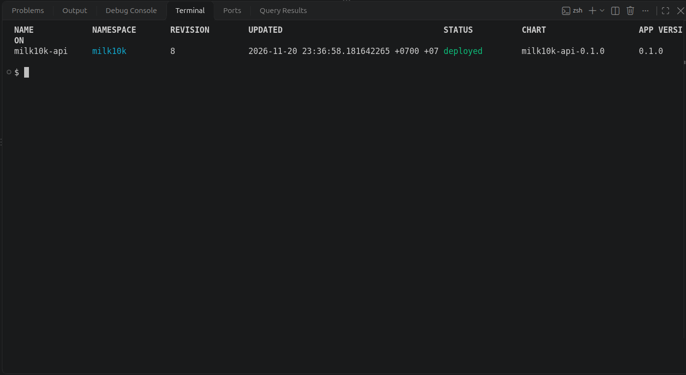</a><br><a href="docs/images/k8s-pods-ci.png">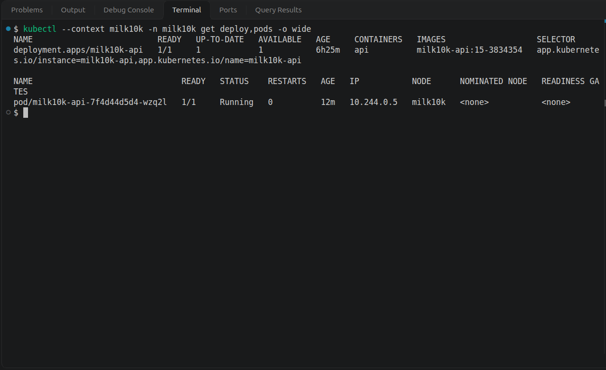</a><br><a href="docs/images/jenkins-k8s-bad-tag.png">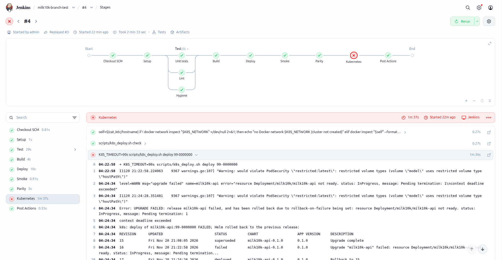</a> |

Screenshots from the reference machine (2026-11-20 and 2026-11-21); click one for the full size.

## Troubleshooting

| Problem | Check | What to look for |
|---|---|---|
| `make up` fails with "port is already allocated" | `ss -tlnp` | Something else listens on 127.0.0.1 port 8000, 9090, 3000 or 16686 (8081 for Jenkins). Processes of other users, such as `docker-proxy`, are only named with `sudo` |
| `permission denied` on `/var/run/docker.sock` | `id -nG` | `docker` is missing: see [Docker without sudo](docs/install-ubuntu.md#docker-without-sudo), then log in again |
| A container restarts or is unhealthy | `docker compose ps`, then `docker compose logs api` | The API waits for its model package; `/ready` explains a failed load |
| The Docker daemon misbehaves | `journalctl -u docker --since '-10 min' --no-pager` | Errors from `dockerd` (readable for members of the `adm` group or with `sudo`) |
| Out of memory, the machine slows down | `free -h`, `top -bn1 \| head -12` | `available` must leave room for the stack (about 2.4 GiB); otherwise close applications before `make up` |
| Out of disk | `df -h /`, `docker system df` | Images and build cache take several GB. Remove only this project's images (`docker image ls milk10k-api`) |

## Licence

- **Code:** MIT, see [LICENSE](LICENSE).
- **MILK10k data:** [ISIC Archive MILK10k](https://challenge.isic-archive.com/data/#milk10k), CC BY-NC 4.0,
  attribution "MILK study team". The images and metadata are not included in this repository.
- **Checkpoints and model package:** derived from the MILK10k data, so they may be used and shared for
  **non-commercial purposes only**, under compatible terms. They are not stored in git.
- **Pretrained initialisation:** the `timm/resnet18.a1_in1k` weights are Apache-2.0.
