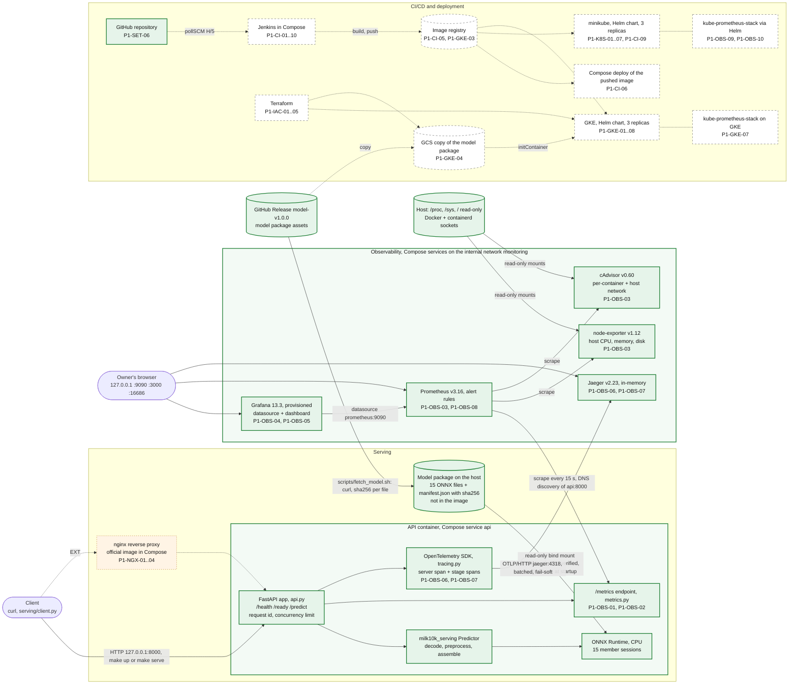
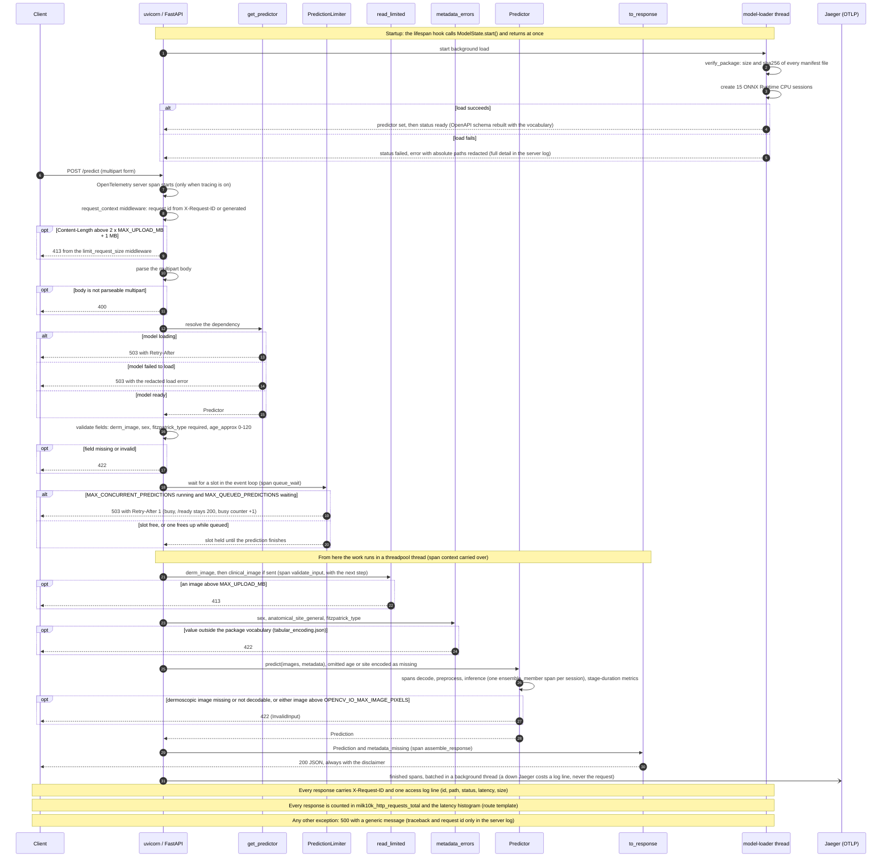
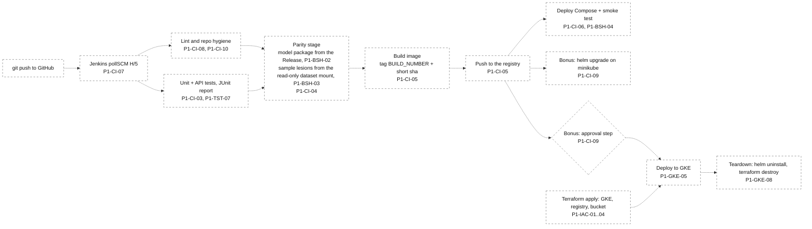

# Architecture

> **Research model, not a medical device.** Its output is not a diagnosis and must not be used for clinical decisions.

Status as of 2026-11-15 (M6 closed: the monitoring stack no longer waits for a healthy API, alert rules unit-tested; M6b: API metrics, Prometheus, node-exporter, cAdvisor, Grafana, Jaeger and OpenTelemetry tracing in Compose; M6a: model fetch script, API image). The diagrams are derived from the code and the project's progress checklist. Task IDs
(`P1-…`) refer to that checklist, which is kept outside this repository. The diagrams are updated at the end of each
milestone.

Styling in every diagram:
- **Solid** box or arrow: implemented.
- **Dashed**: planned.
- **Orange, dotted**: owner's extension beyond the course requirements (`EXT`), planned after the required items.

## 1. Components

| Component | Status | Evidence |
|---|---|---|
| Client | external; example client implemented | Any HTTP client; [`serving/client.py`](../serving/client.py) (standard library only, P1-API-08) |
| FastAPI app (`/health`, `/ready`, `/predict`) | implemented | [`serving/src/milk10k_serving/api.py`](../serving/src/milk10k_serving/api.py); P1-API-01..11; request ids and access log (P1-PY-07); started with `make serve` ([Makefile](../Makefile)) |
| Predictor (decode, preprocessing, assembly) | implemented | [`predictor.py`](../serving/src/milk10k_serving/predictor.py), [`preprocess.py`](../serving/src/milk10k_serving/preprocess.py); P1-PY-05; decoded-image cap P1-API-09 |
| ONNX Runtime, 15 member sessions | implemented | [`package.py`](../serving/src/milk10k_serving/package.py) (`load_package`, `Ensemble`); P1-PY-04 |
| Model package with sha256 manifest | implemented | Built by [notebook 08](../notebooks/08_export_for_deployment.ipynb) (P1-NB-03); verified at startup by `verify_package` (P1-PY-04). Not in git and not in the image: mounted read-only into the container (P1-DCK-02) |
| GitHub Release `model-v1.0.0` | implemented | 19 assets; [`scripts/fetch_model.sh`](../scripts/fetch_model.sh) (`make fetch-model`) downloads them without a token, pins the manifest's sha256 and checks every file (P1-SET-10, P1-BSH-02) |
| `/metrics` (API and model metrics) | implemented | [`metrics.py`](../serving/src/milk10k_serving/metrics.py): requests by route template / method / status, latency histogram, running and waiting predictions, 503-busy counter, model ready / load time / info, stage durations, P(malignant) histogram; labels bounded (unmatched paths → `unmatched`). P1-OBS-01, P1-OBS-02 |
| Prometheus, node-exporter, cAdvisor | implemented | [`monitoring/prometheus/`](../monitoring/prometheus/) (scrape config, 3 alert rules with promtool unit tests in `alert-rules.test.yml`, P1-OBS-08); all 4 targets up (P1-OBS-03). node-exporter and cAdvisor only on the internal network, host folders read-only; cAdvisor also reads the Docker and containerd sockets (Decision log) |
| Grafana (machine resources and API dashboard) | implemented; dashboard checked by the owner (2026-11-15) | [`monitoring/grafana/`](../monitoring/grafana/): provisioned datasource and one dashboard (host, containers, API rows; every panel query returns data through the Prometheus API). Admin password only from `.env`; analytics and update checks off. P1-OBS-04, P1-OBS-05 |
| Jaeger v2 via the OTLP exporter | implemented; UI and span tags checked by the owner (2026-11-15) | [`tracing.py`](../serving/src/milk10k_serving/tracing.py): OTLP/HTTP to `jaeger:4318` when `OTEL_EXPORTER_OTLP_ENDPOINT` is set, FastAPI instrumentation (probes and `/metrics` excluded), stage spans; [`monitoring/jaeger/config.yaml`](../monitoring/jaeger/config.yaml) (in-memory, 10,000 traces). P1-OBS-06, P1-OBS-07 |
| nginx (reverse proxy, load balancing in a Compose profile, GET-only cache exercise) | EXT, planned after the required items | P1-DEC-13, P1-NGX-01..04. Official `nginx` image in Compose only, never the retired community Ingress NGINX on Kubernetes |
| GitHub repository | implemented | Public repository (P1-SET-06) |
| Jenkins in Compose | planned | P1-CI-01..10 |
| Image registry | planned | P1-CI-05; Artifact Registry for GKE: P1-GKE-03, P1-IAC-03 |
| API image | implemented | [`serving/Dockerfile`](../serving/Dockerfile): pinned `python:3.12.16-slim-trixie` (tag + digest), pinned requirements then the package with its `api` extra, no torch, uid 10001, healthcheck on `/ready` with the Python standard library, uvicorn without `--workers` (P1-DCK-01) |
| Docker Compose stack | implemented (api + 5 monitoring services) | [`compose.yaml`](../compose.yaml), `make up` / `make down`: images pinned by tag + digest, model mounted read-only, UIs on 127.0.0.1 only, internal network `monitoring` for scrapes and OTLP, every service `cap_drop: ALL` + `no-new-privileges` + a memory limit without swap + json-file log rotation (10 MB × 3), Prometheus starts with the API without waiting for its health, so an API that cannot load its model still shows up in monitoring (`milk10k_model_ready` 0); Grafana waits for a healthy Prometheus (P1-DCK-03..06); one-command check from a fresh clone: P1-DCK-07 |
| Compose deploy from the registry | planned | P1-CI-06 |
| minikube with a Helm chart, 3 replicas | planned (bonus) | P1-K8S-01..07, P1-CI-09 |
| kube-prometheus-stack via Helm | planned (bonus) | P1-OBS-09, P1-OBS-10; on GKE: P1-GKE-07 |
| Terraform, GKE, GCS copy of the package | planned (bonus) | P1-IAC-01..05, P1-GKE-01..08 (teardown right after the demo: P1-GKE-08) |

## 2. `POST /predict` request path

Derived from [`api.py`](../serving/src/milk10k_serving/api.py). The status codes and the steps that raise them are
listed in that file's docstring and in the OpenAPI `responses`. Form parsing and field validation run inside FastAPI,
before the body of the `predict` handler. `predict` is an `async def` that waits for a slot of the
`PredictionLimiter` in the event loop (a waiting request holds no thread), then runs the blocking work in the
threadpool, so at most `MAX_CONCURRENT_PREDICTIONS` threads do inference (P1-API-05). `/health`, `/ready` and
`get_predictor` are `async def` and never wait for the threadpool.

`GET /health` always returns 200. `GET /ready` returns 503 while loading or after a failed load, and 200 when ready,
also under overload. `GET /metrics` returns the Prometheus text format. All three are `async def`, so they answer while
every prediction slot is busy, and none of them creates a trace. In the container the
same path runs unchanged; the Docker healthcheck polls `/ready` on the container port, so a failed load shows as
`unhealthy` (the process keeps running; Docker restarts it only when it exits).

## 3. CI/CD and deployment flow (all planned)

Lint/hygiene and the unit + API tests run as parallel stages (P1-CI-10). The required path ends at the Compose deploy.
The minikube and GKE branches are bonus items. Measured serving cost, which sizes the replicas and limits, is in
[serving_measurements.md](serving_measurements.md).
