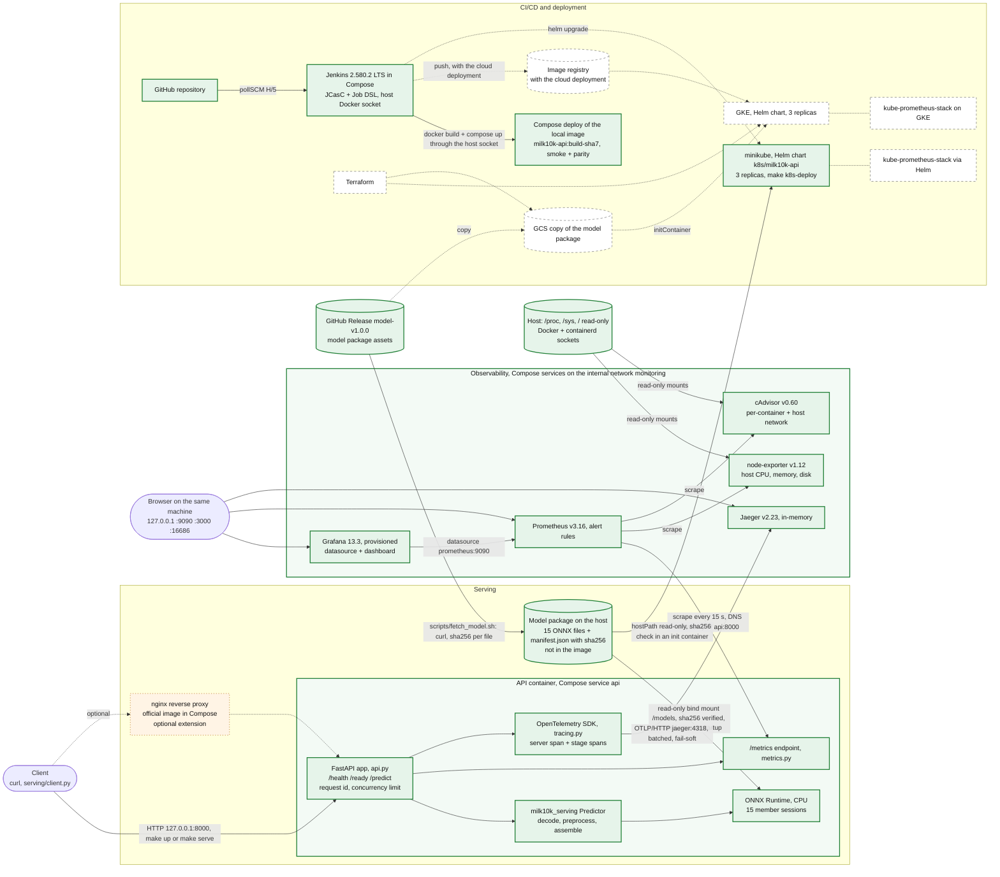
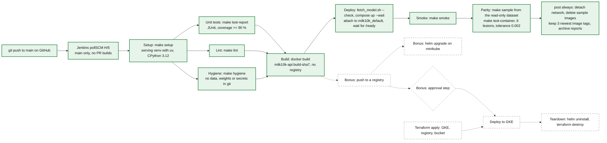
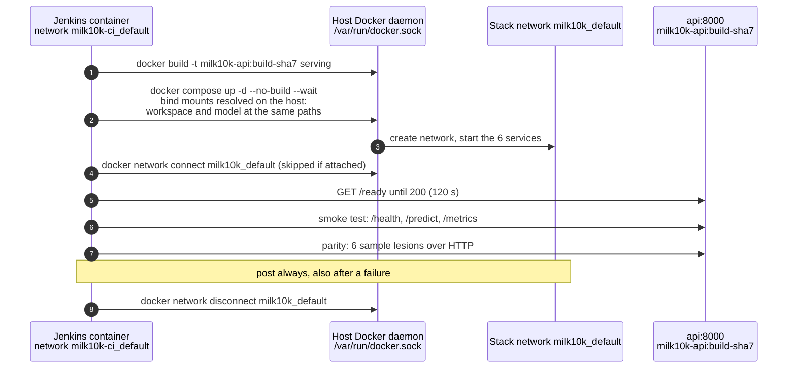
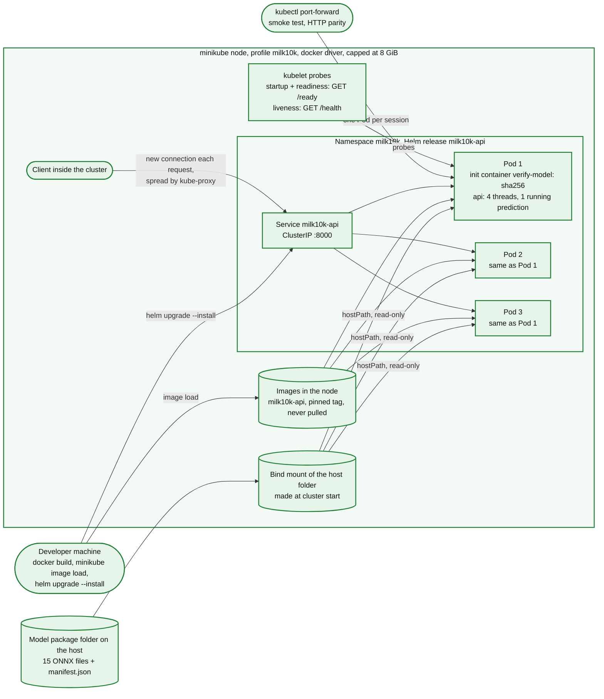

# Architecture

> **Research model, not a medical device.** Its output is not a diagnosis and must not be used for clinical decisions.

Status as of 2026-11-20: the API, its model package and the monitoring stack run with one command (`make up`); a
local Jenkins, configured as code, runs the pipeline test → build → deploy → smoke → parity on every push to `main`;
Prometheus has 4 alert rules. The API also runs as 3 replicas on a local minikube cluster from a Helm chart
(section 6, `make k8s-deploy`). A pipeline stage that deploys to the cluster, monitoring on Kubernetes and the cloud
parts are planned. The diagrams are derived from the code and are updated whenever a part is added.

Styling in every diagram:
- **Solid** box or arrow: implemented.
- **Dashed**: planned.
- **Orange, dotted**: optional extension beyond the course requirements, planned after the required items.

## 1. Components

| Component | Status | Evidence |
|---|---|---|
| Client | external; example client implemented | Any HTTP client; [`serving/client.py`](../serving/client.py) (standard library only) |
| FastAPI app (`/health`, `/ready`, `/predict`) | implemented | [`serving/src/milk10k_serving/api.py`](../serving/src/milk10k_serving/api.py); request ids and access log; started with `make serve` ([Makefile](../Makefile)) |
| Predictor (decode, preprocessing, assembly) | implemented | [`predictor.py`](../serving/src/milk10k_serving/predictor.py), [`preprocess.py`](../serving/src/milk10k_serving/preprocess.py); cap on decoded image pixels |
| ONNX Runtime, 15 member sessions | implemented | [`package.py`](../serving/src/milk10k_serving/package.py) (`load_package`, `Ensemble`) |
| Model package with sha256 manifest | implemented | Built by [notebook 08](../notebooks/08_export_for_deployment.ipynb) ; verified at startup by `verify_package`. Not in git and not in the image: mounted read-only into the container |
| GitHub Release `model-v1.0.0` | implemented | 19 assets; [`scripts/fetch_model.sh`](../scripts/fetch_model.sh) (`make fetch-model`) downloads them without a token, pins the manifest's sha256 and checks every file |
| `/metrics` (API and model metrics) | implemented | [`metrics.py`](../serving/src/milk10k_serving/metrics.py): requests by route template / method / status, latency histogram, running and waiting predictions, 503-busy counter, model ready / load time / info, stage durations, P(malignant) histogram; labels bounded (unmatched paths → `unmatched`) |
| Prometheus, node-exporter, cAdvisor | implemented | [`monitoring/prometheus/`](../monitoring/prometheus/) (scrape config, 4 alert rules with promtool unit tests in `alert-rules.test.yml`: ApiDown incl. a missing target, ApiModelNotReady, ApiHighErrorRate, ApiHighLatencyP95); all 4 targets up. node-exporter and cAdvisor only on the internal network, host folders read-only; cAdvisor also reads the Docker and containerd sockets to name containers, which gives it control over Docker (accepted for a local stack) |
| Grafana (machine resources and API dashboard) | implemented; dashboard checked by eye (2026-11-15) | [`monitoring/grafana/`](../monitoring/grafana/): provisioned datasource and one dashboard (host, containers, API rows; every panel query returns data through the Prometheus API). Admin password only from `.env`; analytics and update checks off |
| Jaeger v2 via the OTLP exporter | implemented; UI and span tags checked by eye (2026-11-15) | [`tracing.py`](../serving/src/milk10k_serving/tracing.py): OTLP/HTTP to `jaeger:4318` when `OTEL_EXPORTER_OTLP_ENDPOINT` is set, FastAPI instrumentation (probes and `/metrics` excluded), stage spans; [`monitoring/jaeger/config.yaml`](../monitoring/jaeger/config.yaml) (in-memory, 10,000 traces) |
| nginx (reverse proxy, load balancing in a Compose profile, GET-only cache exercise) | optional extension, planned after the required items | Official `nginx` image in Compose only, never the retired community Ingress NGINX on Kubernetes |
| GitHub repository | implemented | Public repository |
| Jenkins in Compose | implemented | [`ci/`](../ci/README.md): `jenkins/jenkins:2.580.2-lts-jdk21` by digest + Docker CLI, Buildx, Compose, make, uv; 69 pinned plugins; JCasC + Job DSL (no setup wizard, no anonymous access, UI on 127.0.0.1:8081); host Docker socket (root-equivalent, documented); `make ci-up` / `make ci-down`. [`Jenkinsfile`](../Jenkinsfile): section 3 |
| Image registry | planned (cloud) | No registry for the local pipeline: the deploy runs on the same machine, so the pipeline tags `milk10k-api:<build>-<sha7>` locally and keeps the newest 3. A registry comes with GKE, created by Terraform |
| API image | implemented | [`serving/Dockerfile`](../serving/Dockerfile): pinned `python:3.12.16-slim-trixie` (tag + digest), pinned requirements then the package with its `api` extra, no torch, uid 10001, healthcheck on `/ready` with the Python standard library, uvicorn without `--workers` |
| Docker Compose stack | implemented (api + 5 monitoring services) | [`compose.yaml`](../compose.yaml), `make up` / `make down`: images pinned by tag + digest, model mounted read-only, UIs on 127.0.0.1 only, internal network `monitoring` for scrapes and OTLP, every service `cap_drop: ALL` + `no-new-privileges` + a memory limit without swap + json-file log rotation (10 MB × 3), Prometheus starts with the API without waiting for its health, so an API that cannot load its model still shows up in monitoring (`milk10k_model_ready` 0); Grafana waits for a healthy Prometheus; checked with one command from a fresh clone |
| Compose deploy by the pipeline | implemented | Deploy stage: `docker compose up -d --no-build --wait` with `API_IMAGE_TAG`, model from the CI copy (read-only), Grafana password from a Jenkins credential; then smoke test and HTTP parity against `http://api:8000`. No automatic rollback: a failed deploy is rolled back by hand ([ci/README.md](../ci/README.md)) |
| minikube with a Helm chart, 3 replicas | implemented; checked with 3 replicas | [`k8s/`](../k8s/README.md): Helm chart `milk10k-api` (Deployment + ClusterIP Service, `replicaCount: 3`), local values, namespace; image loaded into the node with a pinned tag; model from the host folder, read-only, sha256-checked by an init container; section 6. A pipeline stage running `helm upgrade` is planned |
| kube-prometheus-stack via Helm | planned (bonus) | locally and on GKE |
| Terraform, GKE, GCS copy of the package | planned (bonus) | torn down right after the demo to limit cost |

## 2. `POST /predict` request path

Derived from [`api.py`](../serving/src/milk10k_serving/api.py). The status codes and the steps that raise them are
listed in that file's docstring and in the OpenAPI `responses`. Form parsing and field validation run inside FastAPI,
before the body of the `predict` handler. `predict` is an `async def` that waits for a slot of the
`PredictionLimiter` in the event loop (a waiting request holds no thread), then runs the blocking work in the
threadpool, so at most `MAX_CONCURRENT_PREDICTIONS` threads do inference. `/health`, `/ready` and
`get_predictor` are `async def` and never wait for the threadpool.

```mermaid
sequenceDiagram
    autonumber
    participant C as Client
    participant U as uvicorn / FastAPI
    participant G as get_predictor
    participant Q as PredictionLimiter
    participant R as read_limited
    participant M as metadata_errors
    participant P as Predictor
    participant T as to_response
    participant L as model-loader thread
    participant J as Jaeger (OTLP)

    Note over U,L: Startup: the lifespan hook calls ModelState.start() and returns at once
    U->>L: start background load
    L->>L: verify_package: size and sha256 of every manifest file
    L->>L: create 15 ONNX Runtime CPU sessions
    alt load succeeds
        L-->>U: predictor set, then status ready (OpenAPI schema rebuilt with the vocabulary)
    else load fails
        L-->>U: status failed, error with absolute paths redacted (full detail in the server log)
    end

    C->>U: POST /predict (multipart form)
    U->>U: OpenTelemetry server span starts (only when tracing is on)
    U->>U: request_context middleware: request id from X-Request-ID or generated
    opt Content-Length above 2 x MAX_UPLOAD_MB + 1 MB
        U-->>C: 413 from the limit_request_size middleware
    end
    U->>U: parse the multipart body
    opt body is not parseable multipart
        U-->>C: 400
    end
    U->>G: resolve the dependency
    alt model loading
        G-->>C: 503 with Retry-After
    else model failed to load
        G-->>C: 503 with the redacted load error
    else model ready
        G-->>U: Predictor
    end
    U->>U: validate fields: derm_image, sex, fitzpatrick_type required, age_approx 0-120
    opt field missing or invalid
        U-->>C: 422
    end
    U->>Q: wait for a slot in the event loop (span queue_wait)
    alt MAX_CONCURRENT_PREDICTIONS running and MAX_QUEUED_PREDICTIONS waiting
        Q-->>C: 503 with Retry-After 1 (busy, /ready stays 200, busy counter +1)
    else slot free, or one frees up while queued
        Q-->>U: slot held until the prediction finishes
    end
    Note over U,T: From here the work runs in a threadpool thread (span context carried over)
    U->>R: derm_image, then clinical_image if sent (span validate_input, with the next step)
    opt an image above MAX_UPLOAD_MB
        R-->>C: 413
    end
    U->>M: sex, anatomical_site_general, fitzpatrick_type
    opt value outside the package vocabulary (tabular_encoding.json)
        M-->>C: 422
    end
    U->>P: predict(images, metadata), omitted age or site encoded as missing
    P->>P: spans decode, preprocess, inference (one ensemble_member span per session), stage-duration metrics
    opt dermoscopic image missing or not decodable, or either image above OPENCV_IO_MAX_IMAGE_PIXELS
        P-->>C: 422 (InvalidInput)
    end
    P-->>U: Prediction
    U->>T: Prediction and metadata_missing (span assemble_response)
    T-->>C: 200 JSON, always with the disclaimer
    U-)J: finished spans, batched in a background thread (a down Jaeger costs a log line, never the request)
    Note over C,L: Every response carries X-Request-ID and one access log line (id, path, status, latency, size)
    Note over C,L: Every response is counted in milk10k_http_requests_total and the latency histogram (route template)
    Note over C,L: Any other exception: 500 with a generic message (traceback and request id only in the server log)
```

`GET /health` always returns 200. `GET /ready` returns 503 while loading or after a failed load, and 200 when ready,
also under overload. `GET /metrics` returns the Prometheus text format. All three are `async def`, so they answer while
every prediction slot is busy, and none of them creates a trace. In the container the
same path runs unchanged; the Docker healthcheck polls `/ready` on the container port, so a failed load shows as
`unhealthy` (the process keeps running; Docker restarts it only when it exits).

## 3. CI/CD and deployment flow

Unit tests, lint and hygiene run as parallel stages; any failure skips every later stage, and the `post`
block still detaches the network and deletes the sample images. Each stage has its own timeout; one executor, no
concurrent builds. The required path ends with parity against the deployed image; the minikube and GKE branches are
bonus items. Measured serving cost, which sizes the replicas and limits, is in
[serving_measurements.md](serving_measurements.md).

## 4. CI network and Docker access

Jenkins talks to the host's Docker daemon through the mounted socket, which is root-equivalent on the host (a `:ro`
mount does not change that; tested). JENKINS_HOME is mounted at the same absolute path inside and outside the
container because the daemon resolves Compose bind mounts on the host. Jenkins joins the stack network only while a
build needs `http://api:8000` and leaves it in `post { always }`; the stack's own `make down` therefore removes the
network cleanly.

## 5. CI design choices

| Topic | Choice | Reason |
|---|---|---|
| Docker access | Host socket; non-root Jenkins with the socket's group, no capabilities, UI on 127.0.0.1, `main` only | Jenkins must build images and run Compose on this machine; Docker-in-Docker is privileged too and would deploy a nested copy, not the stack the README shows |
| JENKINS_HOME | `~/milk10k-ci/jenkins_home`, same absolute path inside and outside | The host daemon resolves Compose bind mounts, so workspace paths must exist on the host |
| Image destination | No registry for the local pipeline; local tag `<build>-<sha7>` | Build and deploy run on the same machine: no credentials, nothing leaves the laptop |
| Model in CI | Read-only hard-linked copy, checked with `fetch_model.sh --check`, never downloaded | The download takes minutes; the check takes about a second |
| Dataset | Read-only mount at its host path, only for `make_sample.py --data-dir` | The sample lesions are dataset images and may not be stored in git |
| Parity | HTTP parity against the deployed API; the 479-lesion test deselected | Proves the image that actually serves; the full run needs the whole dataset |
| Failed deploy | Manual rollback (documented limitation) | Keeps the pipeline simple; the newest 3 image tags stay available |
| Resources | 2 GiB without extra swap, `-Xmx768m`, 1 executor, started on demand | Measured peak about 1.3 GiB; a 16 GB laptop also runs the stack |
| Tests | Inside the Jenkins container with uv and the Makefile; uv cache under JENKINS_HOME | The same commands as on a developer machine; dependencies downloaded once |
| Jenkins image | 2.580.2 LTS on JDK 21 by digest; no kubectl or Helm yet | Current LTS; cluster tools come with the Kubernetes part |
| Configuration | JCasC + Job DSL, setup wizard off, plugins pinned | Jenkins is recreated from the repository alone |
| Secrets | Gitignored `ci/secrets/` files as Compose secrets, loaded by JCasC | No credentials in git or in the image |
| Network | Attach to the stack network at deploy, detach in `post { always }` | Jenkins can start before the stack exists, and `make down` removes the network cleanly |
| Image tag | `image: milk10k-api:${API_IMAGE_TAG:-dev}` in `compose.yaml` | A plain `make up` keeps building `dev`; the pipeline deploys its own tag |
| Failure drill | Through Jenkins Replay | The failure path is tested without a broken commit in the history |
| Python versions | CI tests on CPython 3.12.14, the image on 3.12.16 | Parity runs against the image, so it tests the Python that serves |

## 6. Local Kubernetes deployment

How to run and check it: [k8s/README.md](../k8s/README.md). Measured with 3 replicas:

- **Pod start:** the init container checks every package file against `manifest.json`; then the API loads the 15
  ONNX sessions while `/ready` answers 503, and the startup probe keeps the Pod out of the Service until it is 200.
  3 Pods started together: 3/3 Ready in 10.6 s (sha256 check about 3 s, model load 3.3–3.4 s).
- **Traffic:** the Service spreads new connections over the Ready Pods (30 requests: 11 / 7 / 12).
  `kubectl port-forward` is pinned to one Pod, so it is used only for the smoke and parity tests (parity 2.55e-04,
  tolerance 0.002).
- **Rollout:** one Pod at a time (`maxSurge: 0`, `maxUnavailable: 1`), because a 4th Pod would not fit the memory
  budget. Terminating Pods are not counted, so an old Pod can briefly overlap with its replacement (4 Pods were seen).
  Each old Pod waits 5 s (`preStop` sleep) before it stops, as a precaution; rollouts without it were not tested.
  No failed request out of 373 during a rollout, 183 out of 183 while a Pod was deleted and replaced (Ready again
  after 8.7 s).
- **Resources and security:** see the design table in [k8s/README.md](../k8s/README.md#design-choices) and the
  measurements in [serving_measurements.md](serving_measurements.md).
