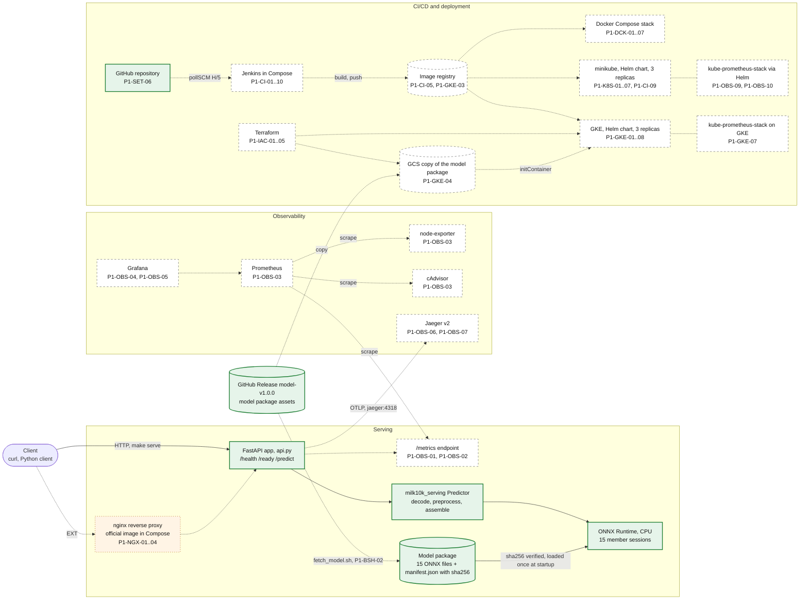
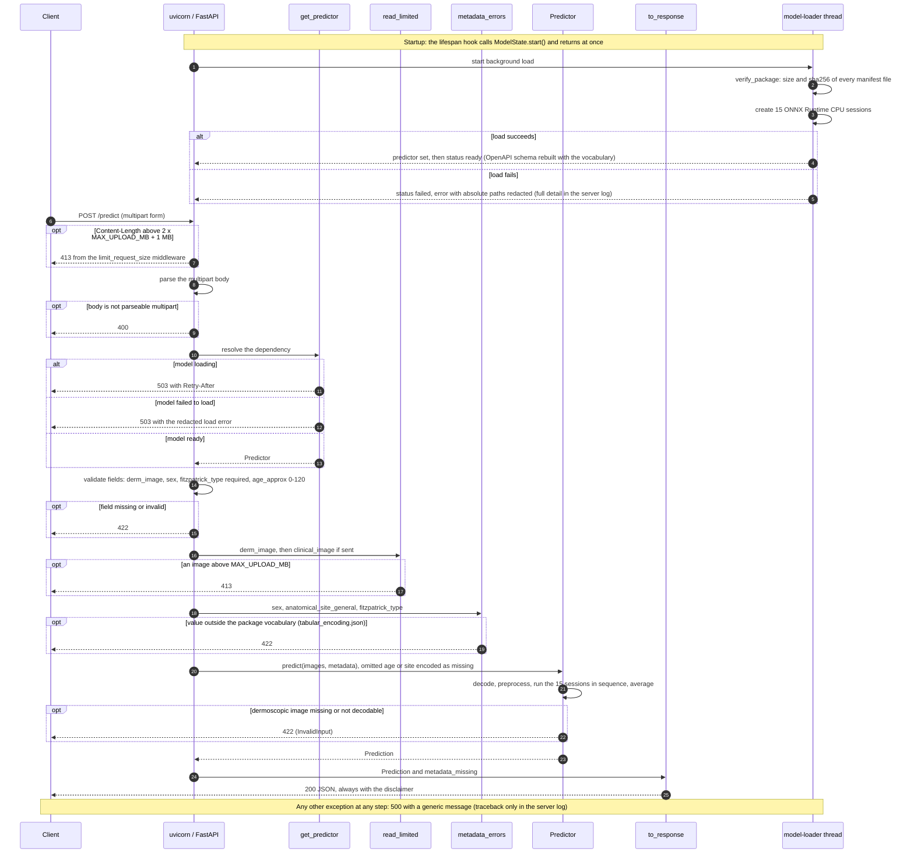
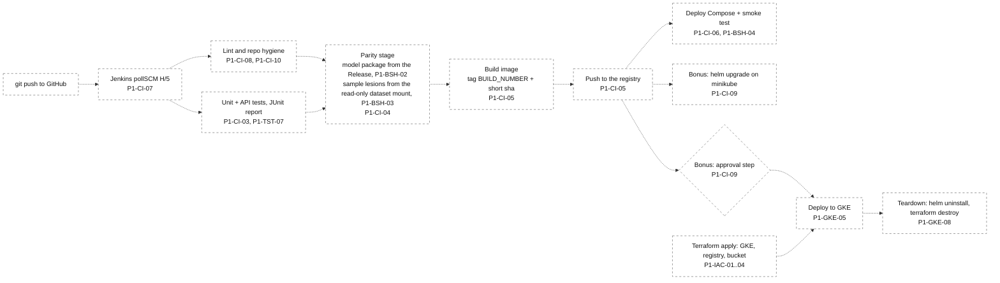

# Architecture

> **Research model, not a medical device.** Its output is not a diagnosis and must not be used for clinical decisions.

Status as of 2026-11-14. The diagrams are derived from the code and the project's progress checklist. Task IDs
(`P1-…`) refer to that checklist, which is kept outside this repository. The diagrams are updated at the end of each
milestone.

Styling in every diagram:
- **Solid** box or arrow: implemented.
- **Dashed**: planned.
- **Orange, dotted**: owner's extension beyond the course requirements (`EXT`), planned after the required items.

## 1. Components

| Component | Status | Evidence |
|---|---|---|
| Client | external | Any HTTP client. A Python client example is planned (P1-API-08) |
| FastAPI app (`/health`, `/ready`, `/predict`) | implemented | [`serving/src/milk10k_serving/api.py`](../serving/src/milk10k_serving/api.py); P1-API-01..04, P1-API-06, P1-API-10, P1-API-11; started with `make serve` ([Makefile](../Makefile)) |
| Predictor (decode, preprocessing, assembly) | implemented | [`predictor.py`](../serving/src/milk10k_serving/predictor.py), [`preprocess.py`](../serving/src/milk10k_serving/preprocess.py); P1-PY-05 |
| ONNX Runtime, 15 member sessions | implemented | [`package.py`](../serving/src/milk10k_serving/package.py) (`load_package`, `Ensemble`); P1-PY-04 |
| Model package with sha256 manifest | implemented | Built by [notebook 08](../notebooks/08_export_for_deployment.ipynb) (P1-NB-03); verified at startup by `verify_package` (P1-PY-04). Not in git |
| GitHub Release `model-v1.0.0` | implemented (assets uploaded) | P1-SET-10 (in progress: download and verification by `scripts/fetch_model.sh`, P1-BSH-02, is planned) |
| `/metrics` (API and model metrics) | planned | P1-OBS-01, P1-OBS-02 |
| Prometheus, node-exporter, cAdvisor | planned | P1-OBS-03, P1-DCK-03 |
| Grafana (host, containers, API dashboards) | planned | P1-OBS-04, P1-OBS-05 |
| Jaeger v2 via the OTLP exporter | planned | P1-OBS-06, P1-OBS-07; the `OTEL_*` settings already exist in [`settings.py`](../serving/src/milk10k_serving/settings.py) and [`.env.example`](../.env.example), but no tracing code yet |
| nginx (reverse proxy, load balancing in a Compose profile, GET-only cache exercise) | EXT, planned after the required items | P1-DEC-13, P1-NGX-01..04. Official `nginx` image in Compose only, never the retired community Ingress NGINX on Kubernetes |
| GitHub repository | implemented | Public repository (P1-SET-06) |
| Jenkins in Compose | planned | P1-CI-01..10 |
| Image registry | planned | P1-CI-05; Artifact Registry for GKE: P1-GKE-03, P1-IAC-03 |
| Docker Compose stack | planned | P1-DCK-01..07 |
| minikube with a Helm chart, 3 replicas | planned (bonus) | P1-K8S-01..07, P1-CI-09 |
| kube-prometheus-stack via Helm | planned (bonus) | P1-OBS-09, P1-OBS-10; on GKE: P1-GKE-07 |
| Terraform, GKE, GCS copy of the package | planned (bonus) | P1-IAC-01..05, P1-GKE-01..08 (teardown right after the demo: P1-GKE-08) |

## 2. `POST /predict` request path

Derived from [`api.py`](../serving/src/milk10k_serving/api.py). The status codes and the steps that raise them are
listed in that file's docstring and in the OpenAPI `responses`. Form parsing and field validation run inside FastAPI,
before the body of the `predict` handler. `predict` is a sync `def`, so it runs in the framework's threadpool. No
explicit concurrency limit exists yet (P1-API-05, planned).

`GET /health` always returns 200. `GET /ready` returns 503 while loading or after a failed load, and 200 when ready.

## 3. CI/CD and deployment flow (all planned)

Lint/hygiene and the unit + API tests run as parallel stages (P1-CI-10). The required path ends at the Compose deploy.
The minikube and GKE branches are bonus items. Measured serving cost, which sizes the replicas and limits, is in
[serving_measurements.md](serving_measurements.md).
